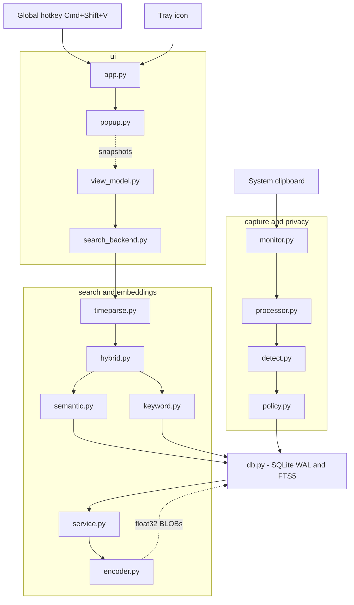
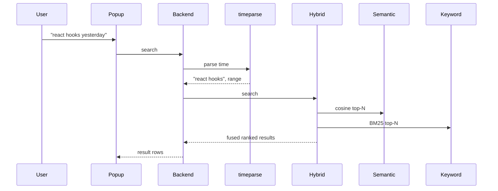

# ClipMind

**A local-first clipboard manager that remembers *what* you copied, not just when — search your clipboard history in plain English, entirely on your machine.**

You copy a SQL query, a React docs link, a meeting note, a confirmation code. The
system clipboard keeps exactly one of them. ClipMind keeps all of them, in a
local SQLite file, and lets you find any of them again with a query like
*"that SQL query about orders I copied yesterday"* or *"the link about React
hooks from this morning"*.

No account, no cloud, no telemetry. The only network access it ever performs is
the one-time download of the ~90 MB embedding model.

**Version 0.6.0** · MIT licensed · macOS first (menu-bar app), Windows/Linux CLI
+ macOS app manually tested; Windows/Linux are CLI-first and UI is untested there (see [Limitations](#limitations)).

---

## Highlights

- 🔍 **Three search modes that cover each other's blind spots** — semantic
  (meaning), keyword (FTS5/BM25 exact match), and hybrid fusion of both. `ERR_4021`
  still matches exactly; "database query" still finds `SELECT id FROM orders;`.
- 🕐 **Time is a first-class filter** — `yesterday`, `last Monday`, `2 hours ago`
  and `between 2pm and 4pm` are parsed out of the query and applied as a date
  range *before* ranking.
- 🔒 **Local-first by construction** — one SQLite file under your user data
  directory. No sync, no API keys, no cloud inference, no telemetry.
- 🛡️ **Privacy filters at the capture boundary** — private keys, credit cards
  (Luhn-checked), passwords, cloud tokens and JWTs are **skipped or masked**
  before they are ever hashed, indexed or embedded. A source-app ignore list
  skips password managers entirely.
- ⚡ **A real menu-bar app** — `Cmd+Shift+V` opens a Spotlight-style popup with
  search-as-you-type, type filters, copy-back, delete + undo, and a tray menu
  (pause, clear, config, quit).
- 🧠 **One warm model per process** — the embedding model loads once on a
  background thread, and the semantic index is built once and updated
  incrementally, so searches never re-read the embedding table.
- 🔀 **A configurable, measured embedding model** — the benchmark compares three
  local models and reports the trade-offs; the smaller default is kept, and
  switching is one config key. Existing databases are protected by a model tag
  that requires `reindex --force`.
- ✅ **483 fast tests** (no model, no network) plus 6 real-model integration
  tests, and a reproducible benchmark harness.

---

## Demo

> 📹 **Placeholder** — a ~30-second screen recording / GIF will live here.
> The exact recording sequence is written out under
> [Demo script](#demo-script); drop the file at `docs/demo.gif` and replace this
> block with ``.

---

## Install & run

### Option 1: Download the macOS app

1. Download `ClipMind.zip` (or the `.dmg`) from the
   [Releases](https://github.com/cnishanth-coder/clipmind/releases) page.
2. Unzip it and move `ClipMind.app` into `/Applications`.
3. Right-click `ClipMind.app` and choose **Open**, then confirm **Open** in the
   warning. The app is unsigned, so Gatekeeper blocks a plain double-click the
   first time.
4. Grant **ClipMind** access to **Accessibility** and **Input Monitoring** in
   **System Settings → Privacy & Security**. If ClipMind is not listed, add it
   with the **+** button.
5. The first launch downloads the `all-MiniLM-L6-v2` model (~90 MB); capture and
   keyword search work while it downloads, and everything is offline afterwards.
6. Press `Cmd+Shift+V` to open the popup.

> **Troubleshooting.** If the hotkey does nothing, remove ClipMind from both
> permission lists (**Accessibility** and **Input Monitoring**) and add it again
> with the **+** button, then restart the app. A rebuilt unsigned app must be
> granted these permissions again.

### Option 2: Run from source

Requires **Python 3.11+** (3.12 is what this repo is developed and tested on).

```bash
git clone https://github.com/cnishanth-coder/clipmind.git
cd clipmind

python3.12 -m venv .venv
source .venv/bin/activate            # Windows: .venv\Scripts\activate
pip install -r requirements.txt      # torch, sentence-transformers, PySide6, pynput
pip install -e .                     # optional: puts `clipmind` on your PATH
```

Then start the desktop app:

```bash
clipmind app
```

A clipboard icon appears in the menu bar (no Dock icon), and `Cmd+Shift+V`
(Windows/Linux: `Ctrl+Shift+V`) opens the popup. The first run downloads the
`all-MiniLM-L6-v2` weights (~90 MB) into `~/.cache/huggingface`; capture, the
tray and keyword search all work while that happens, and everything is offline
afterwards. For higher retrieval quality, set `embedding_model` to
`sentence-transformers/all-mpnet-base-v2` (or the `CLIPMIND_EMBED_MODEL` env var)
and run `clipmind reindex --force` — see [Benchmarks](#benchmarks) for the
measured trade-off.

Prefer the command line? Everything works without the UI:

```bash
clipmind watch                     # capture in the foreground, Ctrl-C to stop
clipmind list                      # what has been captured
clipmind search "database query"   # hybrid + time-aware search
```

See [Usage](#usage) for the full command reference and
[Packaging](#packaging-macos-app) for building a standalone `ClipMind.app`.

---

## Architecture



Query flow:



### Design decisions

- **SQLite + FTS5 in one file.** `items_fts` is an *external-content* FTS5 table
  over `items.content`; triggers keep it in sync on insert/update/delete, so
  there is no second source of truth to drift.
- **Dedup by content hash, not text comparison.** `content_hash` has a `UNIQUE`
  index, so duplicates are rejected by the database even under a write race.
- **Hash the stored text.** Truncation happens before hashing, so two long texts
  sharing a 10,000-character prefix cannot collide.
- **The masked text is what gets stored.** When a secret is masked, the
  `[REDACTED:kind]` form is hashed, embedded and indexed — the raw value never
  reaches the database, the FTS index or the model.
- **Embeddings are float32 BLOBs, not pickles.** 384 dims × 4 bytes = 1536 bytes
  per row for the default `all-MiniLM-L6-v2` (768 dims × 4 = 3072 for
  `all-mpnet-base-v2`), readable from any language, no `.npy` header.
- **The stored model name guards the vector space.** Every batch of embeddings
  records which model produced it; if the configured model changes, search and
  `reindex` refuse until `clipmind reindex --force` rebuilds the vectors, so two
  incomparable vector spaces are never mixed.
- **The model is a lazy singleton** keyed by `(model_name, device)`. Importing the
  package never imports torch; the first `embed_texts` pays for the load, on the
  worker thread. Query/document prefixes come from the model's preset (BGE, E5)
  or from `embedding_query_prefix`/`embedding_document_prefix`.
- **Search is behind a `VectorIndex` protocol.** Swapping in FAISS/Chroma means
  writing a class with `size` and `search`; nothing else changes.
- **User text never reaches the FTS5 parser.** Queries are reduced to quoted
  alphanumeric tokens, so `C++`, URLs and unbalanced quotes can only produce *no
  results*, never an `fts5: syntax error`.
- **Time phrases are parsed by hand, not with `dateparser`.** `dateparser` reads
  `monday.com` as a weekday and a bare `5pm` as a filter; ClipMind needs the
  opposite, so `search/timeparse.py` is a deterministic, dependency-free regex
  parser whose supported phrase set is explicit and testable.
- **The date range is a pre-filter, not a re-rank** — pushed into both
  retrievers' SQL, so ranking never sees rows outside the window.
- **No business logic in the widgets.** `view_model.py`, `hotkey.py`,
  `single_instance.py`, `clipboard.py` and `search_backend.py` import **no Qt**,
  so the interesting behaviour is unit-testable without a display.

---

## How search works

`search` is hybrid by default: semantic similarity (meaning) fused with FTS5
BM25 (exact tokens), with time phrases extracted first.

| You type | What happens |
| -------- | ------------ |
| `search "database query"` | semantic + keyword fusion ranks `SELECT id FROM orders;` first |
| `search "ERR_4021"` | found by the keyword half even though the string embeds poorly; a full-coverage exact hit bypasses the threshold |
| `search "react hooks article yesterday"` | "yesterday" becomes a date filter; only yesterday's entries are ranked |
| `search "monday.com link"` | *not* misread as "last Monday" — searched as-is |
| `search "yesterday"` | a bare time phrase lists that range, newest first |

Supported time phrases: `today`, `yesterday`, `this morning/afternoon/evening`,
`last night`, `N minutes/hours/days/weeks ago`, `last <weekday>`, `this week`,
`last week`, and `between 2pm and 4pm [today|yesterday]`. A bare weekday or clock
time (`monday`, `5pm`) is deliberately left in the query and reported as
ambiguous.

`FINAL = w_sem · SEM + w_kw · KW·coverage`, with `w_sem = 0.7`, `w_kw = 0.3` by
default. `--explain` shows the full `FINAL / SEM / KW / COV` breakdown.

---

## Privacy

ClipMind is local-first by construction:

- **Storage is local.** One SQLite file under your user data directory. Nothing
  is synced or uploaded.
- **No network calls after setup.** The only outbound request in the project is
  the one-time model download from Hugging Face, handled by
  `sentence-transformers`. Afterwards the model is read from local cache and
  every embed/search runs on this machine — no API keys, no accounts, no cloud
  inference, no telemetry. Unplug the network and `search`/`reindex` still work.
- **You can inspect it.** It is a normal SQLite database:
  `sqlite3 ~/Library/Application\ Support/clipmind/clipmind.db "select * from items"`.

### What is detected at capture time

| Category | `kind` | Default action |
| -------- | ------ | -------------- |
| PEM private-key blocks | `private_key` | **skip** |
| Credit-card numbers (13–19 digits, **Luhn-checked**) | `credit_card` | **skip** |
| Password-like assignments (`password=…`, `secret: …`) | `password` | **skip** |
| AWS access key ids (`AKIA…`/`ASIA…`) | `aws_access_key` | mask |
| GitHub tokens (`ghp_…`, `github_pat_…`) | `github_token` | mask |
| Slack tokens (`xoxb-…`) | `slack_token` | mask |
| OpenAI/Anthropic keys (`sk-…`) | `openai_key` | mask |
| Google API keys (`AIza…`) | `google_api_key` | mask |
| JSON Web Tokens | `jwt` | mask |

**skip** = not stored at all. **mask** = stored with the secret replaced by
`[REDACTED:<kind>]`, and the masked text is what gets hashed, embedded and
indexed.

Detection is **best-effort, not a guarantee**: it recognises the shapes above and
nothing more. UUIDs, git hashes, phone numbers, order ids and timestamps are
deliberately not flagged; card numbers must pass Luhn and JWTs must decode to a
header with `alg`, which keeps false positives low.

Captures from a configurable list of apps (1Password, Bitwarden, KeePassXC,
Keychain Access, LastPass by default) are skipped entirely, when the frontmost
app can be determined.

`config.toml` example:

```toml
privacy_enabled = true

[secret_actions]
aws_access_key = "mask"
credit_card = "skip"
```

---

## Usage

All commands run as `clipmind <command>` or `python -m clipmind <command>`.

### Capture

```bash
clipmind watch                    # poll the clipboard in the foreground
clipmind watch --interval 0.2 --capture-initial
clipmind watch --iterations 20    # scripted/demo: poll N times then exit
clipmind watch --no-embed         # capture only; torch is never imported
```

### Inspect and search

```bash
clipmind list [-n 50] [--type links|code|text|email|number|all] [--json]
clipmind stats
clipmind search "database query" [--top 5] [--type code] [--min-score 0.25]
clipmind search "react hooks yesterday" --explain
clipmind search "ERR_4021" --keyword-only      # pure FTS5, no model needed
clipmind search "database query" --semantic-only
clipmind reindex [--batch 32] [--force]       # embed rows that have none yet
                                              # --force re-embeds everything (model change)
```

`search` flags: `--top N`, `-t/--type`, `--min-score S`, `--semantic-only`,
`--keyword-only`, `--explain`, `--json`. `reindex` flags: `--batch N`, `--force`,
`--quiet`.

### Store text directly (demo/scripting)

```bash
clipmind add "https://react.dev/learn/thinking-in-react"
echo "SELECT id FROM orders;" | clipmind add --stdin
```

`add` runs the exact same pipeline as the clipboard poller — same normalisation,
truncation, type detection and dedup.

### Data management

```bash
clipmind pause / resume / status
clipmind delete 42
clipmind clear --yes
clipmind purge --older-than 30d
clipmind config show | config show --template | config path
```

### Configuration

Defaults live in `clipmind/config.py`; an optional `config.toml` overrides them,
and `CLIPMIND_*` environment variables override the file. Precedence:
**env > `config.toml` > defaults**.

`config.toml` location: `$XDG_CONFIG_HOME/clipmind/config.toml` or
`~/.config/clipmind/config.toml` (override with `CLIPMIND_CONFIG`).
Database location: `~/Library/Application Support/clipmind/clipmind.db` (macOS),
`%APPDATA%\clipmind\` (Windows), `$XDG_DATA_HOME/clipmind/` (Linux).

Common keys:

```toml
poll_interval = 0.5
max_chars = 10000
dedup = true
embedding_model = "all-MiniLM-L6-v2"   # or sentence-transformers/all-mpnet-base-v2
# embedding_query_prefix = ""       # empty = the model's built-in preset
# embedding_document_prefix = ""
min_score = 0.25
search_top_k = 5
semantic_weight = 0.7
keyword_weight = 0.3
hotkey = "cmd+shift+v"
theme = "system"            # system | light | dark
hide_dock_icon = true
retention_days = 0          # 0 disables auto-purge
```

Run `clipmind config show --template` for the full documented set.

### Capture rules

| Rule | Behaviour |
| ---- | --------- |
| Empty/whitespace-only | Skipped. |
| Exact duplicate | Skipped (SHA-256 of stored text, `UNIQUE` index). |
| Longer than `max_chars` | Truncated by default; `oversize_policy = "skip"` drops instead. |
| NUL bytes | Stripped. |
| Surrounding blank lines | Stripped; leading indentation preserved so code survives. |
| Content type | `url`/`email`/`number`/`code`/`text` by heuristic. |

---

## Desktop app (`clipmind app`)

`clipmind app` is **one long-running process** owning the clipboard watcher
(with all privacy filters), the embedding service (model loaded once and kept
warm), the tray icon and the global hotkey.

```bash
clipmind app                 # popup + tray + global hotkey
clipmind app --no-hotkey     # tray only
clipmind app --no-embed      # keyword-only search; torch never imported
clipmind app --check         # build everything, print a summary, exit 0
```

A second instance refuses to start — enforced by an advisory `app.lock` next to
the database, which the OS releases automatically when the process exits, so a
crash never leaves a stale lock:

```text
$ clipmind app
ClipMind is already running (pid 4711).
```

**Ctrl-C / `SIGTERM` shut down cleanly.** A signal handler only records the
request; a small `QTimer` lets the interpreter run the handler, then the app
stops the watcher, hotkey listener and embedding worker, releases the lock and
exits 0 — no `KeyboardInterrupt` traceback.

### Popup

- Search-on-type with a 150 ms debounce on a worker thread; superseded searches
  are dropped by a generation counter.
- The same hybrid + time-aware search as the CLI; the detected window appears as
  a dismissible `⏱ Yesterday ✕` chip.
- `↑`/`↓` move, `⏎` copies back and closes, `Esc` closes, `⌘⌫` deletes with an
  undo toast (`⌘Z`), `Tab` cycles **All → Code → Links → Text**. Clicking away
  closes the popup.
- Light/dark follows the system; pin it with `theme`.
- Copy-back is suppressed at both the monitor-baseline and hash-dedup layers, so
  a re-copied entry is never re-stored or bumped.
- If the model is still loading the popup says “Loading model…” and keeps
  working.

### Tray / menu-bar

**Open ClipMind**, **Pause/Resume capture** (mirrors the persisted flag within
~2 s), **Clear history…**, **Open config file**, **Quit ClipMind**. The icon
greys out and gains a slash while paused. On macOS ClipMind is a menu-bar app
with **no Dock icon** (`NSApplication.setActivationPolicy_(Accessory)`, or
`LSUIElement` in the packaged `Info.plist`).

### macOS permission

macOS gates global key monitoring behind **Input Monitoring**. Without it the
hotkey registers but receives nothing, so ClipMind checks on first start and
shows a dialog with the exact steps:

1. **System Settings → Privacy & Security → Input Monitoring**
2. Enable **ClipMind** (or your terminal, when running from a shell) — click
   **+** and add it if missing.
3. Quit and reopen ClipMind.

The tray menu is the fallback until it is granted. `clipmind app --check`
reports the current grant (needs the `pyobjc-framework-Quartz` that `pynput`
installs on macOS).

---

## Packaging (macOS `.app`)

```bash
scripts/build_macos.sh                # build + zip
scripts/build_macos.sh --dmg          # build + DMG
scripts/build_macos.sh --bundle-model # also bundle the embedding model
scripts/build_macos.sh --codesign     # ad-hoc sign the bundle
```

The script installs PyInstaller, generates the placeholder icon if needed, runs
`clipmind.spec`, verifies the bundle, and packages it as `dist/ClipMind.zip`
and/or `dist/ClipMind.dmg`. The bundle is a **menu-bar-only app**
(`console=False`, `LSUIElement`, bundle id `com.clipmind.app`) and stores config
and data in the normal per-user locations.

### Is the model bundled?

**Default: downloaded on first run** (not bundled).

| | Bundled (`--bundle-model`) | Downloaded on first run (default) |
| --- | --- | --- |
| First launch offline | ✅ works | ❌ needs network once |
| App size | + ~87 MB | smaller |
| Update the model | new app release | independent of the app |
| Failure modes | cache-path wiring inside a read-only bundle | a normal HF download |
| CI artifact | larger | smaller |

The decision is *download on first run* because the app is already dominated by
torch and PySide6 (see the sizes below), the one-time download is the same code
path as the plain `pip` install, and it keeps the model updatable without an
app release. `--bundle-model` produces a genuinely air-gapped build for anyone
who needs it: it copies the Hugging Face snapshot into the bundle and points
`HF_HOME` at it with `HF_HUB_OFFLINE=1`.

### Measured sizes (this machine)

Actually built with `scripts/build_macos.sh` on macOS 26.6.2 (Intel, Python
3.12.15):

| Artifact | Size |
| --- | ---: |
| `dist/ClipMind.app` (not bundled model) | **944 MB** |
| `dist/ClipMind.zip` | **305 MB** |

For reference, the on-disk sizes of the components PyInstaller packs (from
`du -sh .venv/lib/python3.12/site-packages/*`):

| Component | Size |
| --- | ---: |
| PySide6 | 1.2 GB |
| torch | 571 MB |
| scipy | 170 MB |
| numpy | 108 MB |
| transformers | 92 MB |
| `all-MiniLM-L6-v2` weights (HF cache) | 87 MB |
| `all-mpnet-base-v2` weights (HF cache) | 438 MB |
| **whole venv** | **2.4 GB** |

Add roughly **+87 MB uncompressed** if you pass `--bundle-model` (**+438 MB** if
you bundle `all-mpnet-base-v2` via `CLIPMIND_BUNDLE_MODEL_NAME`).

### Unsigned-app workaround

The build is **not notarised** (that needs an Apple Developer ID). On first
launch macOS will refuse to open it. Either:

- **Right-click the app → Open**, then click **Open** in the dialog (once only), or
- `xattr -dr com.apple.quarantine /Applications/ClipMind.app`

Gatekeeper may also want **Accessibility** (for copy-back automation, if used)
and **Input Monitoring** (for the global hotkey). Grant both in
**System Settings → Privacy & Security**.

If you plan to sign and **notarise** the bundle, one PyInstaller warning matters:
`sklearn/.dylibs/libomp.dylib` (a transitive dependency of
`sentence-transformers`) reports an invalid macOS SDK version and cannot be
notarised as-is. Strip that dylib or rebuild sklearn from source before
notarising. The other build warnings (Windows/Linux ctypes libraries such as
`ntdll`, `libc.so.6`, `libnvidia-ml.so.1`, and the missing optional
`torch.utils.tensorboard`) are harmless on macOS.

---

## Benchmarks

Reproduce with `python benchmarks/bench_search.py` — it regenerates
[`benchmarks/RESULTS.md`](benchmarks/RESULTS.md), including the per-query ranks.
The corpus (10,000 synthetic entries, fixed seed, timestamps spread over 90 days)
and the 45 hand-written labelled `query → expected entry` pairs (30 general + 15
code-focused) are deterministic; timings are machine-dependent.

**Measured on** Intel Core i9-9880H @ 2.30 GHz, macOS 26.6.2 (x86_64), Python
3.12.15, PyTorch 2.2.2 (8 threads), sentence-transformers 3.4.1, device `mps:0`
(auto-selected). One run; the machine was otherwise idle. See
[`benchmarks/RESULTS.md`](benchmarks/RESULTS.md) for the raw numbers, p99/mean/max
and every per-query rank.

**Task 1 — index reuse.** Semantic p50 fell from **228 ms to 44 ms** (hybrid
234 ms → 50 ms) once the index is built once and updated incrementally instead of
re-read per query (`all-MiniLM-L6-v2`, same corpus).

**Task 2 — model comparison (default kept: `all-MiniLM-L6-v2`).**

| Model | Dim | Weights | Embed | semantic p50 | hybrid top-5 | code top-5 |
| --- | ---: | ---: | ---: | ---: | ---: | ---: |
| `all-MiniLM-L6-v2` | 384 | 91 MB | 451 texts/s | 44 ms | 71% | 60% |
| `BAAI/bge-small-en-v1.5` | 384 | 133 MB | 398 texts/s | 75 ms | 58% | 48% |
| `sentence-transformers/all-mpnet-base-v2` | 768 | 438 MB | 251 texts/s | 82 ms | **80%** | **80%** |

`all-mpnet-base-v2` ranked highest: **+8.9 points** hybrid top-5 overall and
**+20 points** on the 15 code-focused queries. It was not adopted as the default
because the total cost is not clearly acceptable for a lightweight local tool —
4.8x the weights (438 MB vs 91 MB), 1.7x the hybrid latency (86 ms vs 50 ms p50),
half the embedding throughput, and it needs `min_score` re-tuned (at the shipped
threshold a relevant hit drops out). It remains a one-key opt-in:
`embedding_model = "sentence-transformers/all-mpnet-base-v2"` (or
`CLIPMIND_EMBED_MODEL`) plus `clipmind reindex --force`. BGE's recommended query
instruction was applied; it still measured below MiniLM here.

For the default model the detailed figures are: load **7.5 s**, corpus embedding
**22.2 s** (**451 texts/s**), hybrid p50/p95 **50 ms / 62 ms**, hybrid top-5
**71%** (60% keyword, 69% semantic). Timings vary run to run with host load; the
corpus and the quality figures are reproducible.

---

## Continuous integration

[`.github/workflows/ci.yml`](.github/workflows/ci.yml):

- **`tests`** — runs the fast suite on **macOS** and **Windows** (Python 3.12).
  Torch/transformers are deliberately *not* installed: the suite uses a
  deterministic fake embedder, so CI stays a couple of minutes.
- **`build-macos`** — on a `v*` tag (or manual dispatch), builds
  `ClipMind.app`, zips it, makes a DMG, and uploads them as artifacts. The
  artifact is built for the runner's architecture (arm64 on GitHub's Apple
  Silicon runners); build Intel or other-arch bundles locally with
  `scripts/build_macos.sh`.

**Untested on Windows** (documented, not silently assumed):

- signal-driven shutdown (`Ctrl-C`/SIGTERM) is POSIX-only; the corresponding
  tests skip on Windows and the clean-shutdown path there is unverified;
- the global hotkey backend, the tray icon and the popup have only been
  exercised on macOS;
- `source_app` detection is macOS-only;
- there is no Windows installer (PyInstaller build) yet.

---

## Testing

```bash
pip install -r requirements.txt
python -m pytest              # 483 passed, 6 skipped, ~11 s — no model, no network
python -m pytest --runslow    # + 6 integration tests against the real model
```

The fast suite uses a deterministic fake embedder (`tests/fakes.py`) and never
loads torch or touches the network. It covers content-type detection,
normalisation/truncation/hashing, schema + FTS5 sync, dedup (including the
unique-index race path), date-range and type filters, the monitor's
baseline/dedup/stats behaviour, the BLOB codec, the numpy vector index, the
embedding worker (including that capture never blocks on a slow embedder),
reindex eligibility/idempotence/progress, the time-phrase parser (including the
ambiguous `monday.com` case), FTS5 query sanitising and BM25 normalisation,
hybrid fusion (weights, merge-by-id, exact-keyword threshold bypass, date
pre-filtering), secret detection and the skip/mask policy (including that a
masked secret never reaches the DB, FTS index or embedding input), the
source-app ignore list, pause/resume, retention purge, `config.toml`
loading/validation, every CLI command, and the display-free popup view-model.

Phase 5/6 add: the single-instance lock (including across processes), hotkey
parsing, copy-back suppression, the search-backend adapter, an offscreen
`pytest-qt` popup smoke test, `clipmind app --check` wiring, and —
new in 0.6.0 — **clean shutdown on `SIGINT`/`SIGTERM`**, both as a unit test and
as a real subprocess test that asserts exit code 0, no traceback and a released
instance lock.

### Manual test checklist (needs a real GUI/hotkey session)

The development sandbox has **no display and no Input Monitoring grant**, so the
following are written but **unverified** and must be checked by hand:

- [ ] `clipmind app` shows a menu-bar icon and **no** Dock icon.
- [ ] `Cmd+Shift+V` toggles the popup from another app (incl. full-screen); the
      search box has focus immediately.
- [ ] Typing filters the list within ~150 ms without freezing the UI.
- [ ] `↑`/`↓`/`⏎`/`Esc`/`Tab`/`⌘⌫`/`⌘Z` behave as described.
- [ ] Clicking another app closes the popup.
- [ ] `⏎` copies back; the reopened popup shows the same single entry (no new
      row, no bumped timestamp).
- [ ] Tray **Pause/Resume** toggles the icon and stops/starts capture, and
      `clipmind pause` in a terminal updates the menu within ~2 s.
- [ ] Tray **Clear history…** confirms, then empties the list.
- [ ] Tray **Open config file** opens `config.toml` (creating it if missing).
- [ ] On a fresh machine the first run shows the Input Monitoring dialog with
      the right steps; granting it and reopening makes the hotkey work.
- [ ] Switching macOS appearance (and `theme = "dark"`) re-themes the popup.
- [ ] `Ctrl-C` in the terminal running `clipmind app` exits with code 0, prints
      no traceback, and leaves no `app.lock` behind.
- [ ] A second `clipmind app` prints "already running" and exits 2.
- [ ] `open dist/ClipMind.app` (after right-click → Open) shows the tray icon
      and stores config/data in `~/Library/Application Support/clipmind/` and
      `~/.config/clipmind/config.toml`.

---

## Roadmap

- **Optional ANN index** (FAISS/Chroma) behind the existing `VectorIndex` seam for
  corpora beyond ~50k entries.
- **Windows/Linux packaging** (installer + tray behaviour) and a Windows CI smoke
  test for the UI.
- **Notarised macOS build** (Developer ID + hardened runtime).
- **Encryption at rest** for the SQLite file.
- **Native clipboard events** (macOS `NSPasteboard` change count) instead of
  polling.
- **Rich content** — images and file paths.

---

## Limitations

- **Text only.** No images, files or rich content.
- **One process at a time.** `clipmind app` refuses to start twice; `watch` is a
  separate foreground command. Run one against a database, not both.
- **`source_app` is usually empty on macOS** unless `pyobjc` is installed.
- **Type detection is heuristic.** A one-line SQL statement without punctuation
  may be labelled `text`; prose with two uppercase SQL keywords may be `code`.
- **The hybrid threshold applies to the combined score.** With 0.7/0.3 weights a
  purely semantic hit needs cosine ~0.36 to clear `min_score = 0.25`.
- **Keyword tokens are OR-joined.** A partial hit may be returned; its `COV` is
  shown under `--explain` and it is only rescued from the threshold when *all*
  tokens are present.
- **The time parser supports a fixed phrase set** (see above); anything else stays
  in the query, and ambiguous shapes are reported rather than filtered.
- **Numbers and very short entries are never embedded** — keyword search still
  finds them.
- **`min_score` is a global threshold** tuned for `all-MiniLM-L6-v2`; changing
  the model needs re-tuning (the benchmark shows `all-mpnet-base-v2` scores
  differently). Scores are not calibrated probabilities.
- **Brute-force vector search does not scale forever.** Every query needs the
  whole matrix in memory (~75 MB at 50k entries) and — currently — decodes it
  after any change. Fine to ~50k entries; see the roadmap.
- **The embedding model is a hard dependency for `search`/`reindex`.**
  `watch --no-embed` and all Phase 1 commands work without torch. When the model
  is missing, `search`/`reindex` print one actionable line to stderr and exit 1,
  and a running `watch` keeps capturing.
- **No encryption at rest.** The SQLite file relies on filesystem permissions.
- **Secret detection is best-effort.** A secret in an unlisted format is stored
  unmasked.
- **The source-app ignore list needs app detection** (macOS + `pyobjc`), so it
  cannot fire everywhere; the secret detectors still run.
- **The UI was verified headlessly, not visually.** Real rendering, the menu-bar
  app, the permission dialog and the hotkey itself were not exercised in the
  sandbox — use the manual checklist.
- **Windows/Linux UI is untested**; menu-bar/Dock behaviour is macOS-only.
- **The `.app` is unsigned/not notarised** — see the workaround above.
- **Undo re-inserts a deleted row with its original timestamp and embedding**, but
  with a new id.

---

## Demo script

A ~30-second recording sequence (this is what the demo GIF will show). Use a
throwaway database:

```bash
export CLIPMIND_DB=/tmp/clipmind_demo.db
rm -f "$CLIPMIND_DB"*
clipmind app
```

1. **Capture** — copy each of these in any app:
   `https://react.dev/learn`, `SELECT id FROM orders WHERE total > 100;`,
   `Meeting notes for the Q3 roadmap planning session`, `react hooks article`.
2. **Open** — press `Cmd+Shift+V`. Four entries appear, newest first.
3. **Search** — type `react hooks`; the article jumps to the top. Press `Tab` to
   cycle filters.
4. **Time filter** — type `react hooks yesterday`; a `⏱ Yesterday` chip appears.
5. **Explain** — click **Explain** to reveal `final/semantic/keyword`.
6. **Copy back** — `↓` then `⏎`; the popup closes and the text is on the
   clipboard. Reopen: still one entry, no bumped timestamp.
7. **Delete + undo** — `Cmd+Backspace`, then `Cmd+Z`.
8. **Pause** — tray → **Pause capture**; the icon greys out.

---

## Project layout

```
clipmind/
├── clipmind/
│   ├── config.py             # Config dataclass + env overrides + data paths
│   ├── __main__.py           # `python -m clipmind`
│   ├── capture/              # detect, monitor, processor, source_app, cli
│   ├── storage/              # db.py (schema, FTS5, dedup), models.py
│   ├── embeddings/           # codec, encoder (lazy model), service (worker)
│   ├── search/               # vector_index, semantic, keyword, hybrid, timeparse
│   ├── privacy/              # detectors, policy
│   └── ui/                   # view_model, search_backend, hotkey,
│                             # single_instance, clipboard, theme, popup, tray, app
├── benchmarks/
│   ├── bench_search.py       # 10k-entry, real-model benchmark harness
│   └── RESULTS.md            # measured results (regenerated by the script)
├── packaging/
│   ├── clipmind_launcher.py  # PyInstaller entry point
│   ├── ClipMind.icns         # placeholder app icon
│   └── ClipMind-icon.png
├── scripts/
│   ├── build_macos.sh        # PyInstaller build + zip/DMG
│   └── make_icon.py          # regenerate the placeholder icon
├── tests/                    # pytest suite (incl. offscreen pytest-qt smoke test)
├── clipmind.spec             # PyInstaller spec
├── requirements.txt
├── pyproject.toml
├── LICENSE                   # MIT
└── README.md
```

---

## Verified vs. not

**Verified in the development environment** (macOS 26.6.2, Intel, Python 3.12.15):

- the full fast test suite (**483 passed, 6 skipped**), the offscreen app wiring
  (`clipmind app --check`), cross-process single-instance locking, and clean
  shutdown on `SIGINT`/`SIGTERM` (exit 0, lock released, no traceback);
- the benchmark numbers above, measured with the real model;
- `scripts/build_macos.sh` **end to end**: it produced `dist/ClipMind.app`
  (944 MB), `dist/ClipMind.zip` (304 MB), `Info.plist` with
  `CFBundleIdentifier = com.clipmind.app` and `LSUIElement = true`;
- the frozen bundle **runs**: `Contents/MacOS/ClipMind app --check` exits 0, and
  `add` → `reindex` → `search "database query"` works inside the `.app`,
  proving torch + sentence-transformers are bundled correctly (the model loads
  and scores the SQL entry first);
- the icon generator (`scripts/make_icon.py` produced a valid `.icns`).

**Not verified here — run it yourself:**

- the **GUI**: launching the built `ClipMind.app`, the menu-bar/tray icon, the
  global hotkey, real rendering, permissions. The sandbox has no interactive
  session, so the frozen app was only exercised via `--check` (and the model path
  via `search`). Follow the checklist `scripts/build_macos.sh` prints and the
  [manual test checklist](#manual-test-checklist-needs-a-real-guihotkey-session).
- Windows/Linux UI behaviour and the Windows CI leg.

---

## License

MIT — see [`LICENSE`](LICENSE). Third-party components keep their own licenses
(PySide6/LGPL, PyTorch/BSD, `sentence-transformers`/Apache-2.0, the
`all-mpnet-base-v2` model weights/Apache-2.0).
